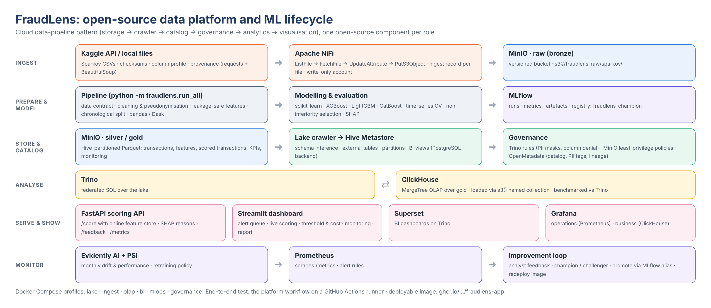
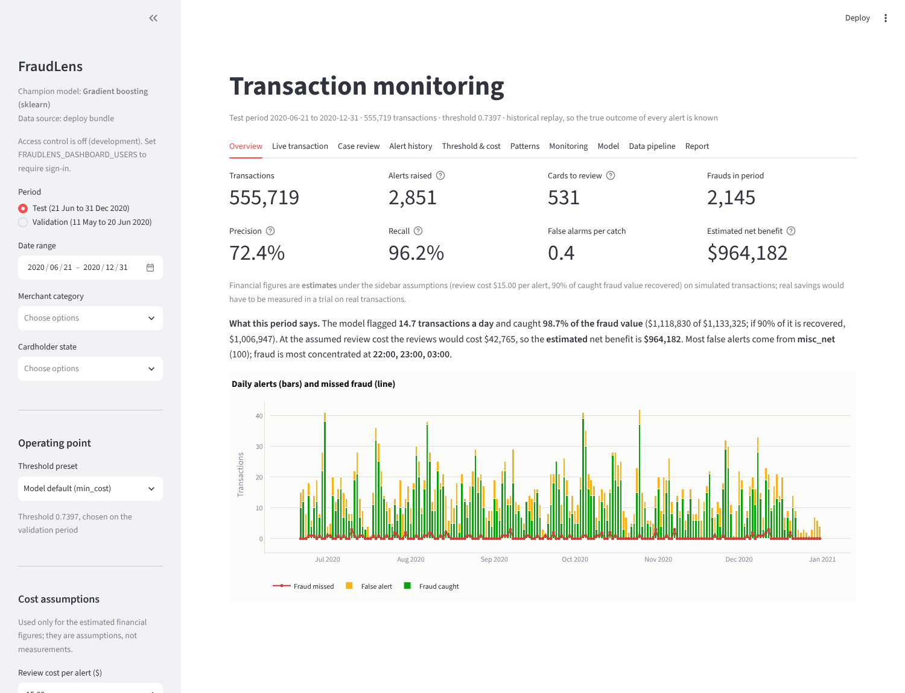

# FraudLens

[](https://github.com/anasua2905/fraudlens-or-credit-card-fraud-detection/actions/workflows/ci.yml)
[](https://github.com/anasua2905/fraudlens-or-credit-card-fraud-detection/actions/workflows/platform.yml)
[](https://github.com/anasua2905/fraudlens-or-credit-card-fraud-detection/actions/workflows/deploy.yml)

**An anomaly detection framework for fraudulent credit card transactions**, built end to end on open-source
tools: from data acquisition to a deployed scoring API, an analyst dashboard and drift monitoring.

PRT661 (Charles Darwin University), Theme 3: Anomaly Detection and Intelligent Monitoring. Group project.

| | |
|---|---|
| Data | Sparkov simulated card transactions (Kaggle `kartik2112/fraud-detection`, CC0): 1.85 M transactions, 2019-2020 |
| Champion | HistGradientBoosting (scikit-learn), chosen by a pre-registered non-inferiority rule |
| Test period (Jun-Dec 2020, never used for any choice) | **recall 0.962**, **precision 0.724**, **14.7 alerts/day**, PR-AUC 0.970 (251× the random baseline) |
| Business impact (test, estimate) | 98.7% of fraud dollars caught; **estimated** net benefit $964k, assuming $15 per review and 90% of caught fraud recovered (an estimate on simulated data, not demonstrated savings) |
| Verification | 56/56 automated end-to-end checks pass (`reports/verification_report.json`) |
| Live path | a new transaction → online features → model → case in the review queue → analyst decision → live-precision monitoring and new labels, behind role-based API keys and a dashboard sign-in ([user guide](docs/user_guide.md), [API](docs/api.md)) |
| Data platform | runs end to end on a GitHub runner: 14/14 smoke checks pass, ClickHouse 14-23× faster than Trino with the same answers, OpenMetadata catalog with PII tags and lineage ([platform guide](docs/platform.md#latest-verified-run)) |

## The lifecycle, stage by stage

Each stage has a notebook (executed on the full dataset, outputs embedded), a module in `src/fraudlens`, and
open-source tools:

| # | Stage | Notebook | Code | Tools |
|---|---|---|---|---|
| 1 | Problem understanding | [01](notebooks/01_problem_understanding.ipynb) | `config/pipeline.yaml` | Jupyter, Markdown |
| 2 | Data acquisition | [02](notebooks/02_data_acquisition.ipynb) | `acquire.py`, `platform/nifi` | Kaggle API, requests, BeautifulSoup, **Apache NiFi**, **MinIO** |
| 3 | Data preparation | [03](notebooks/03_data_preparation.ipynb) | `validate.py`, `clean.py`, `features.py`, `split.py` | pandas, **Dask**, PyArrow |
| 4 | Exploratory analysis | [04](notebooks/04_eda.ipynb) | `eda.py`, `interactive.py` | pandas, Seaborn, Matplotlib, Plotly |
| 5 | Modelling | [05](notebooks/05_modelling.ipynb) | `preprocess.py`, `models.py`, `tuning.py`, `train.py`, `selection.py` | scikit-learn, XGBoost, LightGBM, CatBoost, **MLflow** |
| 6 | Evaluation & interpretation | [06](notebooks/06_evaluation_interpretation.ipynb) | `evaluate.py`, `explain.py` | sklearn metrics, **SHAP**, ELI5, Yellowbrick |
| 7 | Deployment & visualisation | [07](notebooks/07_deployment_visualisation.ipynb) | `api.py`, `dashboard/app.py`, `publish.py`, `crawler.py`, `olap.py` | **FastAPI**, **Streamlit**, Docker, **Trino**, **ClickHouse**, **Superset** |
| 8 | Monitoring & improvement | [08](notebooks/08_monitoring_improvement.ipynb) | `monitor.py`, `tracking.py` | **Evidently AI**, **Prometheus**, **Grafana**, MLflow |

## The open-source data platform

The cloud data-pipeline pattern (storage → crawler → catalog → governance → analytics → visualisation),
implemented with open-source components in `platform/docker-compose.yml`:

| Role | Cloud pattern | FraudLens |
|---|---|---|
| Storage | S3 | **MinIO**: `fraudlens-raw` (versioned) / `fraudlens-silver` / `fraudlens-gold`, Hive-partitioned Parquet |
| Crawler / ingest | Glue crawler | **Apache NiFi** flow (landing folder → raw layer, ingest record per file) + Python lake crawler |
| Catalog | Glue Data Catalog | **Apache Hive Metastore** (PostgreSQL backend) |
| Governance | Lake Formation | **Trino** access rules (PII masks, column denial), least-privilege **MinIO** policies, **OpenMetadata** (catalog, PII tags, lineage) |
| Analytics | Athena / Redshift | **Trino** over the lake and **ClickHouse** (MergeTree), benchmarked on the same questions |
| Visualisation | QuickSight | **Apache Superset** (BI over Trino), **Grafana** (operations from Prometheus, business from ClickHouse), Streamlit (analysts) |
| ML ops | SageMaker | **MLflow** tracking and registry, **FastAPI** scoring service, **Evidently** drift reports |

```
Kaggle / local ─► NiFi ─► MinIO raw ─► pipeline (pandas/Dask) ─► MinIO silver/gold ─► crawler ─► Hive Metastore
                                                                                     ├─► Trino ─► Superset
                                                                                     └─► ClickHouse ─► Grafana
champion model ─► FastAPI /score (online feature store) ─► Prometheus ─► Grafana
               └─► Streamlit dashboard ◄─ analysts (feedback ─► monitoring ─► retraining)
```



See [docs/architecture.md](docs/architecture.md) for the details and [docs/platform.md](docs/platform.md) to run it.

## Quick start

Python 3.11 is recommended (3.10-3.12 work).

```bash
python -m venv .venv && . .venv/bin/activate          # Windows: .venv\Scripts\activate
pip install -c requirements.lock.txt -e ".[ml,serve,platform,data,dev]"

# the data: Kaggle API (needs ~/.kaggle/kaggle.json) or a folder that has fraudTrain.csv and fraudTest.csv
python -m fraudlens.run_all --source kaggle            # or: --local-dir path/to/folder
python -m fraudlens.run_all --quick                    # a faster trial run (200k training rows, no tuning)

streamlit run dashboard/app.py                          # analyst dashboard   -> http://localhost:8501
uvicorn fraudlens.api:app --port 8000                   # scoring API (docs)  -> http://localhost:8000/docs
python scripts/build_notebooks.py --execute             # re-execute the eight lifecycle notebooks
pytest                                                  # tests (synthetic sample data, ~5 minutes)
```

The full run on the real data takes several hours on a laptop, mostly hyper-parameter tuning; every stage can be
resumed (`--start train`) or run alone (`--only monitor`).

The data platform (needs Docker, about 12 GB RAM for everything):

```bash
cp platform/.env.example platform/.env                 # then change the passwords
cd platform && docker compose --profile lake --profile ingest --profile olap --profile mlops up -d
cd .. && python -m fraudlens.run_all --ingest nifi     # NiFi ingest ... publish, crawl, ClickHouse
```

## Deployment



| | |
|---|---|
| Application image | `platform/docker/Dockerfile.app` (model + API + dashboard); the `deploy` workflow builds, smoke-tests and publishes it as `ghcr.io/anasua2905/fraudlens-app` |
| Hosted dashboard | Streamlit Community Cloud from this repository, `dashboard/app.py` (runs from the committed 40 MB bundle) |
| Local | `scripts/deploy/run_local.ps1` (Windows) starts the API and the dashboard; optional public tunnel |

Details: [docs/deployment.md](docs/deployment.md).

## Deliverables

| | |
|---|---|
| Final report (Word) | [deliverables/FraudLens_Final_Report.docx](deliverables/FraudLens_Final_Report.docx) |
| Presentation (PowerPoint, speaker notes = talk script) | [deliverables/FraudLens_Final_Presentation.pptx](deliverables/FraudLens_Final_Presentation.pptx) |
| Live demo script | [docs/demo_script.md](docs/demo_script.md) |
| Executed notebooks, one per lifecycle stage | [notebooks/](notebooks/) |

Both documents are generated from the result files (`node scripts/build_report.js reports <out.docx>`,
`node scripts/build_deck.js reports <out.pptx>`), so their numbers always match the run.

## Documentation

| Document | For |
|---|---|
| [Problem statement](docs/problem_statement.md) | goals, stakeholders, success criteria, cost model |
| [Architecture](docs/architecture.md) | lifecycle, data platform, data flow, design decisions |
| [Data dictionary](docs/data_dictionary.md) | raw, silver and gold tables, features, PII classification |
| [Model card](docs/model_card.md) | intended use, data, metrics, fairness, limitations |
| [User guide](docs/user_guide.md) | the dashboard, tab by tab |
| [API reference](docs/api.md) | endpoints, request/response examples |
| [Platform guide](docs/platform.md) | running the Docker platform, credentials, troubleshooting |
| [Deployment guide](docs/deployment.md) | image, hosted dashboard, local deployment |
| [Monitoring runbook](docs/monitoring_runbook.md) | drift, alerts, retraining and promotion |
| [GitHub Project guide](docs/github_project.md) | managing the project and tracking progress on GitHub |
| [Demo script](docs/demo_script.md) | the live walk-through for the presentation |

## Repository layout

```
config/pipeline.yaml        every setting: paths, features, models, thresholds, monitoring, platform
src/fraudlens/              the package: one module per lifecycle step (run_all.py orchestrates)
notebooks/                  eight executed notebooks, one per lifecycle stage
dashboard/app.py, bundle/   Streamlit dashboard and its self-contained deploy bundle
platform/                   docker compose: MinIO, NiFi, Hive Metastore, Trino, ClickHouse, Superset,
                            MLflow, API, Prometheus, Grafana; openmetadata/ for governance
reports/                    JSON reports, figures, interactive HTML, monitoring
scripts/                    notebook builder, report builder, CI helpers, GitHub project setup, deployment
deploy/github/              CI/CD workflows, issue and PR templates (install into .github/)
deliverables/               final report (.docx) and presentation (.pptx)
tests/                      unit and end-to-end tests on synthetic sample data
archive/assessment-2/       the earlier (Assessment 2) version, kept for reference
```

## Limitations

The data are simulated, so absolute scores are optimistic compared with real card data; the framework, the
evaluation protocol and the platform are what transfer. See the [model card](docs/model_card.md).

## Licence

Code: MIT. Data: CC0 (Kaggle `kartik2112/fraud-detection`, generated with the Sparkov generator).
