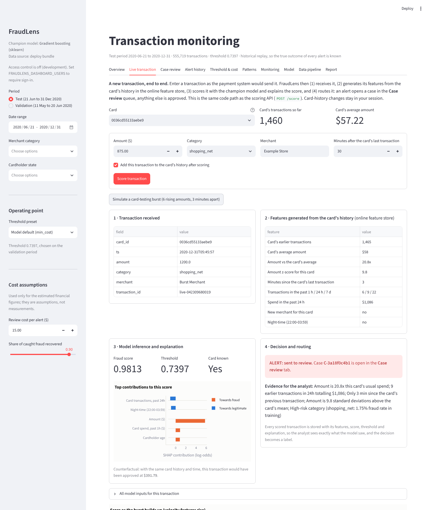
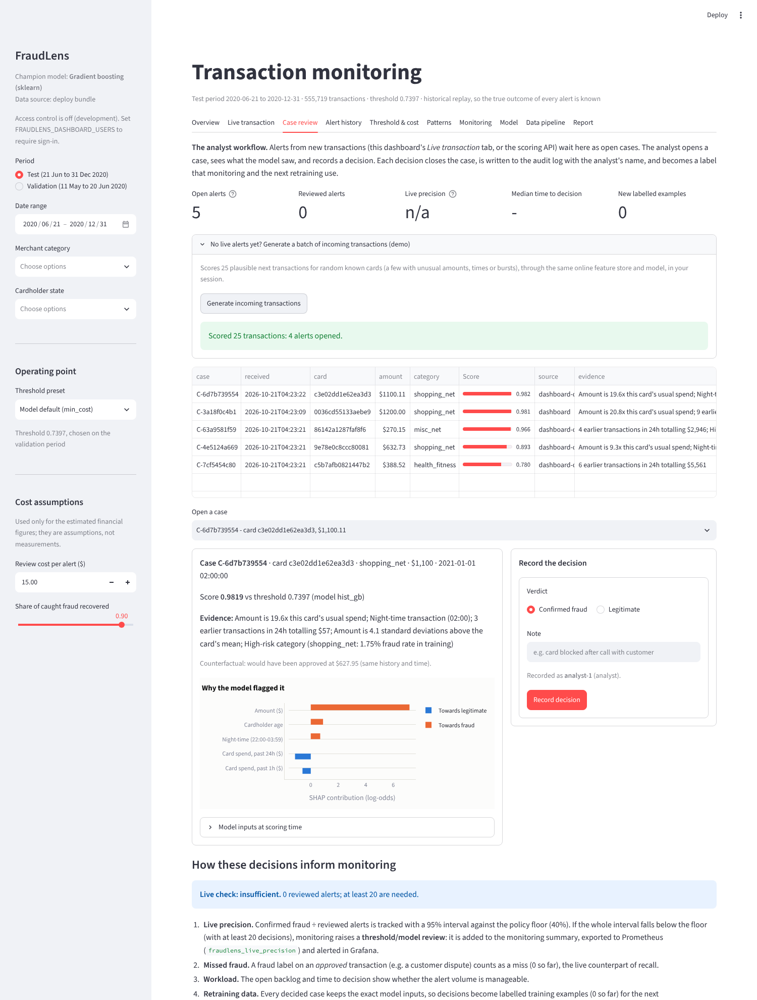
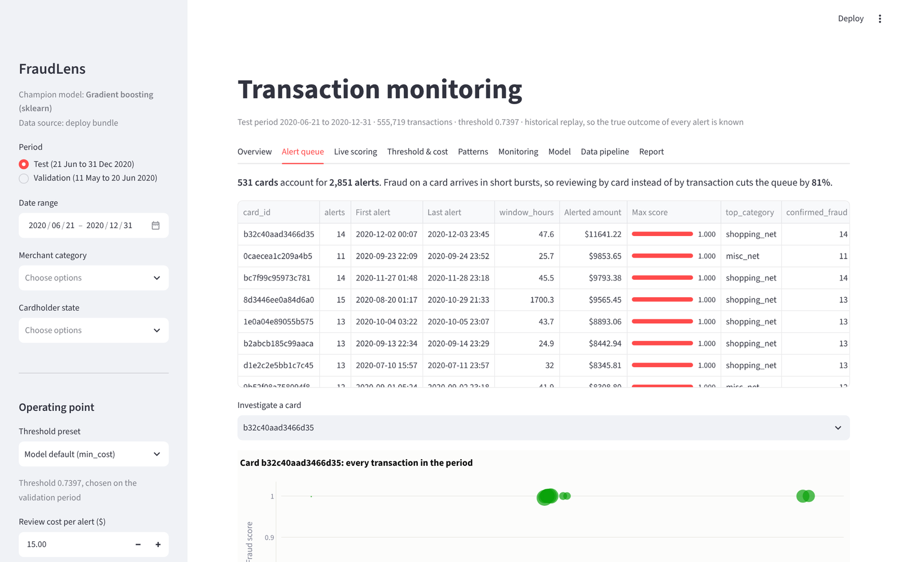
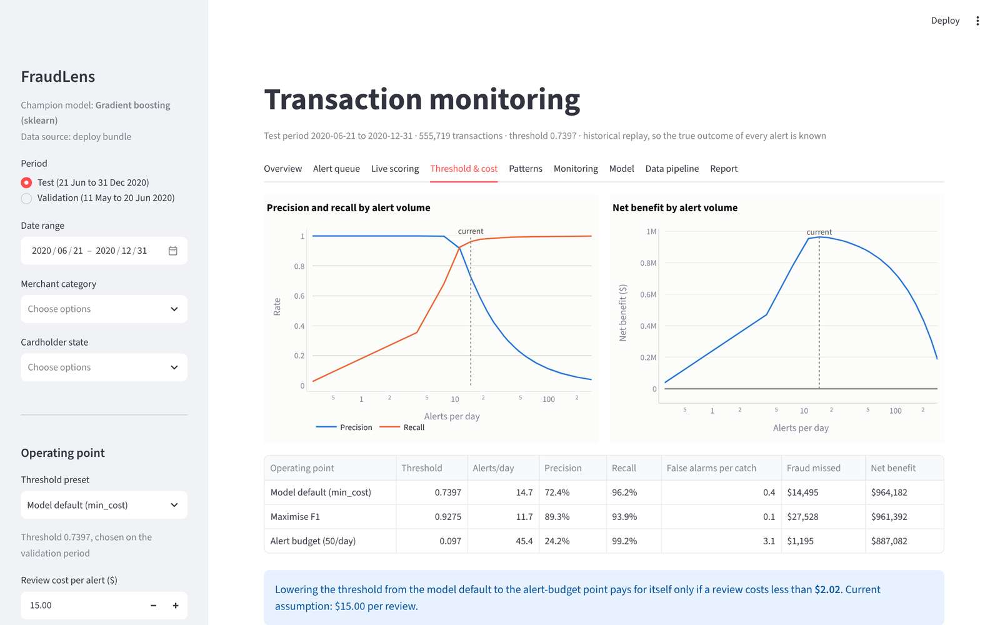
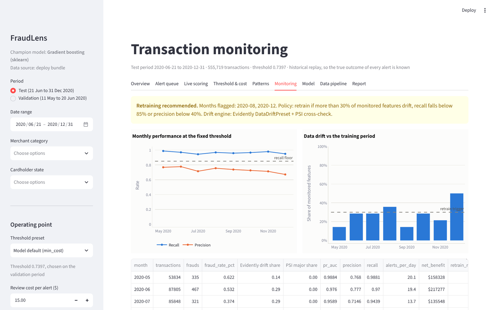
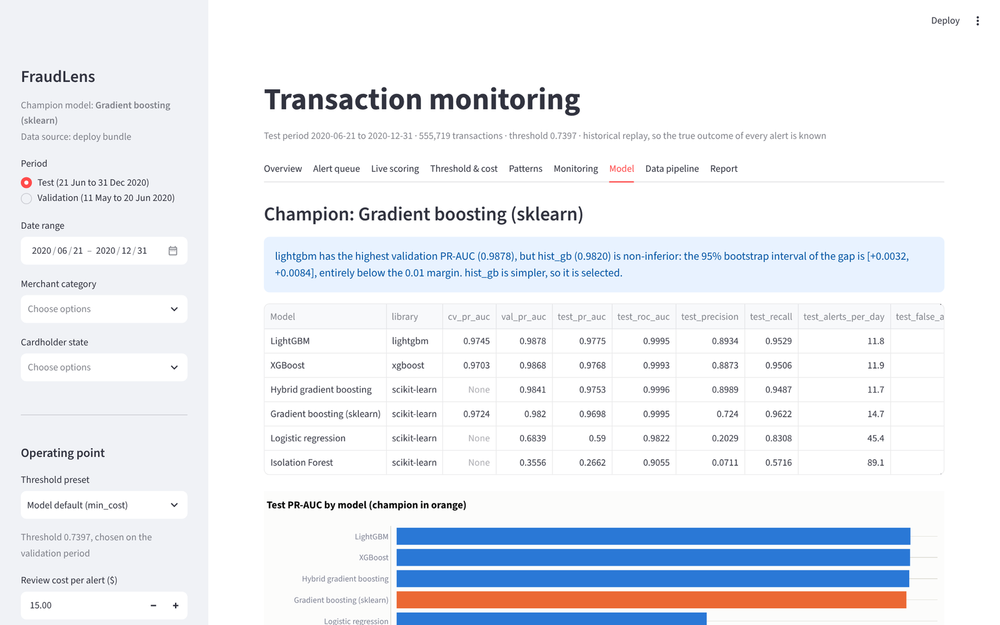

# User guide: the FraudLens dashboard

Open the hosted dashboard (link in the README), or run it yourself:

```bash
streamlit run dashboard/app.py          # http://localhost:8501
```

The dashboard runs from the full pipeline output when it exists, otherwise from the deploy bundle
(`dashboard/bundle`), so the hosted version shows exactly the submitted model and data.

## Signing in

When the deployment sets `FRAUDLENS_DASHBOARD_USERS` (always with `run_local.ps1 -Public`), the dashboard asks
for a user name and password. **Analysts** can record decisions; **viewers** can explore but not decide. The
signed-in name is stored with every decision. Without the setting (local development) access control is off and
decisions are recorded as `analyst-1`.

## Sidebar: what you are looking at

| Control | Effect |
|---|---|
| **Period** | *Test* (Jun-Dec 2020, unseen by the model) or *Validation* (May-Jun 2020, used to pick the threshold) |
| **Date range**, **Merchant category**, **Cardholder state** | filter every tab |
| **Threshold preset** | *Model default (min_cost)* (the deployed, cost-optimal threshold), *Maximise F1*, *Alert budget (50/day)*, or *Custom* (slider) |
| **Cost assumptions**: review cost per alert, share of caught fraud recovered | the assumptions behind the *estimated* net benefit; change them to see what-if results. The financial figures are estimates under these assumptions, not demonstrated savings |

All numbers on every tab recompute from these settings.

## Tabs

### Overview


KPIs for the filtered period: transactions, fraud, alerts, alerts per day, recall (fraud caught), precision
(alerts that are fraud), fraud dollars caught and missed, review cost and the **estimated** net benefit, with the
assumptions it rests on shown beside it. Charts: daily alerts by outcome (caught / false alert) and missed fraud,
money caught vs missed.

### Live transaction: a new transaction, end to end


Enter a transaction (card, amount, category, merchant, time) as the payment system would send it, and follow it
through four steps:

1. **Received**: the raw transaction.
2. **Features generated**: the online feature store computes the card-history features from the card's earlier
   transactions (count, average spend, amount vs average, z-score, minutes since the last transaction, velocity
   over 1 h / 24 h / 7 d, new merchant, night-time), the same code the API uses.
3. **Model inference**: the champion scores it against the threshold; SHAP shows the top contributions, and for an
   alert a counterfactual gives an amount at which it would have been approved.
4. **Routing**: an alert opens a **case** in the Case review queue; anything else is approved and logged.

*Simulate a card-testing burst* sends six rising amounts three minutes apart to show velocity features pushing the
score up. *Reset* restores your session's card history.

### Case review: the analyst workflow


The review queue of open cases from new transactions (this dashboard or the scoring API), highest score first.
Open a case to see what the model saw: score vs threshold, the evidence, SHAP contributions, the counterfactual and
the exact model inputs. Record **Confirmed fraud** or **Legitimate** with a note; the case closes and the decision
is written to the audit log with your name. *Generate incoming transactions* fills the queue with a demo batch.

**How decisions inform monitoring** (shown under the queue): confirmed ÷ reviewed alerts is the *live precision*,
tracked with a 95% interval against the policy floor; a fraud label on an approved transaction counts as a miss;
the backlog and time to decision show the workload; and every decided case becomes a labelled training example
(download it for retraining, or let `python -m fraudlens.monitor` export it). The audit log can be downloaded too.

### Alert history


The historical replay of the test period, where every alert's true outcome is known: cards ranked by their
highest score, with the number of alerts and the amount at risk. Pick a card to see its timeline and each
transaction's score and **reasons**. Decisions recorded here go to the same case store (marked *replay*).

### Threshold & cost


The trade-off curve: recall, precision, alerts per day and estimated net benefit across thresholds, with the current
operating point marked, and the break-even review cost (the cost per alert at which a lower threshold stops
paying for itself). Use it to agree an operating point with the operations manager.

### Patterns
Fraud and alert performance by merchant category, hour of day, amount band and state: where fraud happens and
where the model is weaker.

### Monitoring


Month-by-month drift share (Evidently and PSI) and recall/precision at the deployed threshold, with the
retraining recommendation and its reasons; **monthly stability** with 95% intervals per month, the floors and a
chi-square test of month-to-month variation; and the **live feedback** verdict from analyst decisions.

### Model


Champion, why it was selected (the non-inferiority rule), the comparison of all candidates, SHAP importance and
the test metrics with confidence intervals; **explanation quality** (do the SHAP reasons point at what the model
used?); and **how far the results transfer** to real data: precision and alert volume at other fraud rates and
false-alarm rates, plus what to validate before relying on the numbers.

### Data pipeline
Lineage from the raw files to the gold tables, data-quality results and the verification checklist.

### Report
A plain-language summary of the current selection that can be downloaded and shared.

## Typical workflows

* **Daily review (analyst):** Case review → open the top case → read the evidence and contributions → record the
  verdict; check the backlog and live precision.
* **Weekly review (manager):** Overview for the last week → Threshold & cost if the queue is too long or the
  catch rate dropped → agree a threshold.
* **Monthly model review (data scientist):** Monitoring → if retraining is recommended, follow the
  [monitoring runbook](monitoring_runbook.md).
