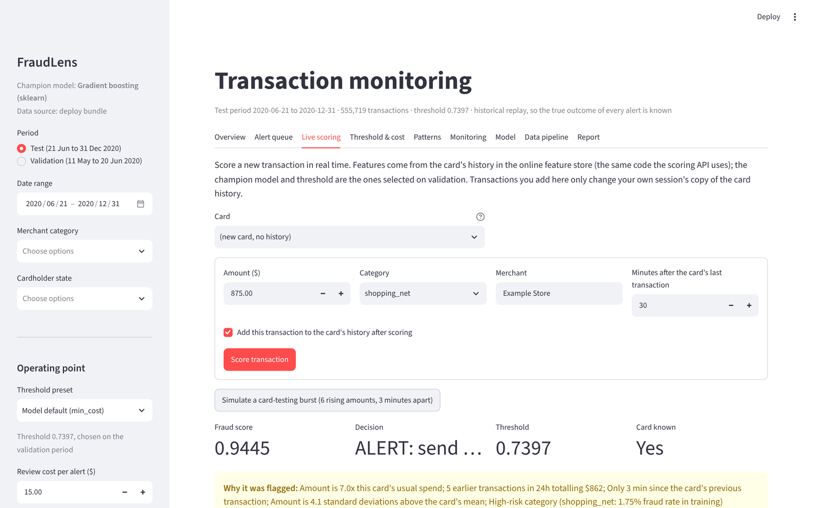

# User guide: the FraudLens dashboard

Open the hosted dashboard (link in the README), or run it yourself:

```bash
streamlit run dashboard/app.py          # http://localhost:8501
```

The dashboard runs from the full pipeline output when it exists, otherwise from the deploy bundle
(`dashboard/bundle`), so the hosted version shows exactly the submitted model and data.

## Sidebar: what you are looking at

| Control | Effect |
|---|---|
| **Period** | *Test* (Jun-Dec 2020, unseen by the model) or *Validation* (May-Jun 2020, used to pick the threshold) |
| **Date range**, **Merchant category**, **Cardholder state** | filter every tab |
| **Threshold preset** | *Model default (min_cost)* (the deployed, cost-optimal threshold), *Maximise F1*, *Alert budget (50/day)*, or *Custom* (slider) |
| **Review cost per alert**, **Share of caught fraud recovered** | the cost model behind *net benefit*; change them to see what-if results |

All numbers on every tab recompute from these settings.

## Tabs

### Overview


KPIs for the filtered period: transactions, fraud, alerts, alerts per day, recall (fraud caught), precision
(alerts that are fraud), fraud dollars caught and missed, review cost and net benefit. Charts: daily alerts by
outcome (caught / false alert) and missed fraud, money caught vs missed.

### Alert queue


The analyst's work list: cards ranked by their highest score in the period, with the number of alerts and the
amount at risk. Pick a card to see its timeline and each transaction's score and **reasons** (top SHAP
contributions, plus plain-language rules such as "Amount is 13× this card's usual spend").
Record a verdict (fraud / legitimate) in the **feedback** form; download your decisions or every alert as CSV.
Feedback is how labels flow back into monitoring and retraining.

### Live scoring


Type a transaction (card, amount, category, time) and score it with the same runtime as the API: the online
feature store computes the card's history features, the model scores, and you see the decision and reasons.
*Simulate a card-testing burst* sends six rising amounts three minutes apart to show how velocity features
push the score up. *Reset* restores your session's card history.

### Threshold & cost


The trade-off curve: recall, precision, alerts per day and net benefit across thresholds, with the current
operating point marked, and the break-even review cost (the cost per alert at which a lower threshold stops
paying for itself). Use it to agree an operating point with the operations manager.

### Patterns
Fraud and alert performance by merchant category, hour of day, amount band and state: where fraud happens and
where the model is weaker.

### Monitoring


Month-by-month drift share (Evidently and PSI) and recall/precision at the deployed threshold, with the
retraining recommendation and its reasons; links to the Evidently reports.

### Model


Champion, why it was selected (the non-inferiority rule), the comparison of all candidates, SHAP importance and
the test metrics with confidence intervals.

### Data pipeline
Lineage from the raw files to the gold tables, data-quality results and the verification checklist.

### Report
A plain-language summary of the current selection that can be downloaded and shared.

## Typical workflows

* **Daily review (analyst):** Alert queue → highest-risk card → read the reasons → record the verdict.
* **Weekly review (manager):** Overview for the last week → Threshold & cost if the queue is too long or the
  catch rate dropped → agree a threshold.
* **Monthly model review (data scientist):** Monitoring → if retraining is recommended, follow the
  [monitoring runbook](monitoring_runbook.md).
